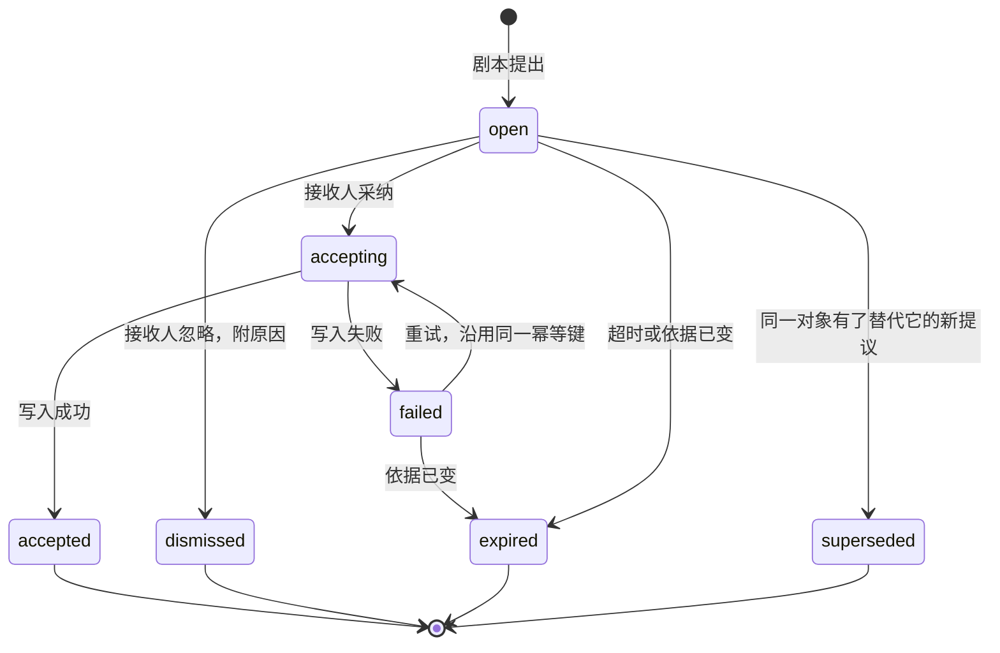

## Day82 - 提议与采纳

> 多 Agent 与主动 Agent ｜ 建议用时 1 小时

> **一句话**：主动 agent 只把“建议怎么做”连同依据交给人，人点了采纳，系统才以这个人的身份去写。
>
> **放在全局看**：这是课程“模型提议、人或代码裁决”的立场在主动 agent 上的落点。它把 Day41 的人工确认从“运行中暂停等人”改成“异步的提议收件箱”，写入时的身份沿用 Day41 和 Day59，幂等沿用 Day40。

### 学习目标

- 能列出一条提议必须带的字段，说清每个字段的用途。
- 能画出提议的生命周期，并写出采纳时的执行步骤。

### 核心概念

**打个比方**：像图书馆的荐购单：馆员写好书目和推荐理由，放进采购员的待办。采购员签字后系统才下单，订单上署的是采购员的名字；单子放久了、书已经绝版了，这张荐购单就作废。

**agent 只提议，从不直接写入**

剧本的 `propose` 工具只往提议存储里写一条记录，剧本本身不持有目标系统的写权限。原因有三：运行时没人在场，写错了没人当场拦；依据可能在提议和处理之间发生变化；审计记录里的每次变更都应当对应到一个人。

**一条提议带什么**

| 字段 | 用途 |
| --- | --- |
| `id` | 唯一标识，同时作为采纳时写入的幂等键 |
| `playbook`、`playbook_version` | 哪个剧本的哪个版本提出的，评估和回滚都靠它 |
| `subject` | 关于哪个对象，Day83 的“每个对象一条”按它去重 |
| `kind` | 动作类（执行一个变更）或草稿类（生成一份待审的草稿） |
| `summary`、`rationale` | 建议做什么、为什么，事实和推断分开写（Day85） |
| `evidence` | Day80 的 `Evidence` 对象列表，每条带来源版本 |
| `payload` | 采纳后要执行的结构化内容 |
| `recipient` | 个人或角色 |
| `priority`、`expires_at` | 投递排序和自动过期用（Day83） |
| `status` | 生命周期中的当前状态 |

**生命周期**



`accepting` 这个中间状态的作用是“先记后做”（Day40）：写入目标系统是一次外部调用，可能超时、可能中途重启。先把状态改成 `accepting` 再执行，恢复时看到它就知道写入可能已经发生，用同一个幂等键重试，目标系统据此去重。`dismissed` 要求附原因，原因决定 Day83 的静默期，也是 Day85 忽略率分析的数据来源。

**路由到个人或角色**

提议可以发给具体的人，也可以发给一个角色，例如某个主题的知识管理员。发给角色时，在投递那一刻解析出当前成员，人员变动不需要改剧本。投递前检查接收人两项权限：能不能对目标对象执行这次写入，能不能看到依据。展示依据时按接收人的权限过滤（Day21）；关键依据接收人看不到时，这条提议不发给他，转给剧本的负责人。

**采纳时由后端以采纳人的身份执行**

```python
ALLOWED = {
    "open": {"accepting", "dismissed", "expired", "superseded"},
    "accepting": {"accepted", "failed"},
    "failed": {"accepting", "expired"},
}

def accept(proposal_id: str, user, store, target) -> str:
    p = store.get(proposal_id)
    if p.status not in {"open", "failed"}:
        return "already_handled"
    if not target.can_write(user, p.subject):
        return "no_permission"                    # 状态不变，界面提示改派
    if any(target.current_version(e.source_id) != e.source_version for e in p.evidence):
        store.transition(p.id, frm=p.status, to="expired", reason="evidence_changed")
        return "expired"
    if not store.transition(p.id, frm=p.status, to="accepting", by=user.id):
        return "already_handled"                  # 并发点击，或别人先处理了
    r = target.apply(p.payload, as_user=user, idempotency_key=p.id)
    store.transition(p.id, frm="accepting", to="accepted" if r.ok else "failed", reason=r.reason)
    return "accepted" if r.ok else "failed"
```

`store.transition` 是一次带条件的更新：只有当前状态等于 `frm`、且 `frm → to` 在 `ALLOWED` 里时才成功，在数据库里相当于 `UPDATE ... WHERE id = ? AND status = ?`。两个人同时点采纳，只有一个能把状态改成 `accepting`。`target.apply` 用采纳人的身份调用目标系统，审计记录里写的是这个人。采纳前接收人修改过 `payload` 时，执行修改后的版本，原版和修改版都留档。

**草稿类提议仍走正常的审核流程**

“补充一篇关于退订规则的说明”这类提议，采纳的结果是在知识库里以采纳人的名义创建一份草稿。草稿之后照常经过知识库的审核和发布，提议的 `accepted` 只表示“草稿已创建”。主动 agent 不因为人点过一次采纳，就绕过目标模块原有的流程。

### 阅读材料

- [12-Factor Agents](https://github.com/humanlayer/12-factor-agents) 第 7 条“用工具调用联系人类”

### 动手练习

**20 分钟必做**

1. 为 Day81 列出的一个剧本设计提议卡片：卡片上展示哪些字段、依据怎样展示、“忽略”时可选哪几种原因。

**课后选做**

1. 为 `accept` 写四个测试：两次并发采纳只执行一次写入；依据版本变化时进入 `expired`；写入失败后重试使用同一幂等键；没有写权限时状态不变。

### 自检

1. 去掉 `accepting` 状态、采纳时直接写入再标 `accepted`，在什么情况下会出问题？
2. 提议发给一个角色时，为什么要在投递时才解析成员，而不是在剧本运行时？

### 参考说明

- [12-Factor Agents](https://github.com/humanlayer/12-factor-agents)：第 7 条把联系人类、请人批准做成 agent 的一种结构化动作。本课的提议收件箱是这一思路的异步形式。
- 其余的讲解、比方、示例和练习为本课程自己编写。
