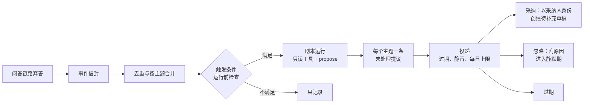

## Day86 - 阶段实战：一个主动提醒剧本

> 多 Agent 与主动 Agent ｜ 建议用时 1～2 天

> **一句话**：用一个“知识缺口提醒”剧本，把事件、合并、受限运行、带依据的提议、采纳和防噪串成一条能验收的链路。
>
> **放在全局看**：Day80~83 的零件在这里组装，Day85 的评估场景用来验收。这是主线项目里第一个没人提问也会工作的能力，之后再加剧本，都可以照这条链路复制。

### 学习目标

- 端到端实现一个剧本：同一主题在一段时间内多次出现资料不足的回答时，向知识管理员提议补充资料。
- 用验收清单和 Day85 的评估场景逐条检查自己的实现。

### 核心概念

**整条链路**



**需求**

| 功能 | 要求 | 对应课程 |
| --- | --- | --- |
| 事件 | 问答链路每次弃答时发出 `answer.insufficient` 事件；信封只带 trace ID、主题标签、去标识化的问题摘要和幂等键 | Day17、Day81 |
| 合并 | 按（剧本，主题）开窗口合并；重复投递只算一次 | Day81 |
| 触发条件 | 代码判断：窗口内同一主题的资料不足次数达到阈值，且来自的提问人数达到下限，避免一个人反复提问就触发 | Day81 |
| 运行前检查 | 剧本开关、静默期、每日 token 预算；预算用完时排队 | Day83 |
| 剧本运行 | 只读工具查现有资料和弃答记录；只能通过 `propose` 产出；步数上限、token 预算、停止原因 | Day45、Day81 |
| 组件契约 | 每个工具和步骤返回带状态的结果，每个在自己的 span 里；证据对象原样传递 | Day80 |
| 提议 | 说明缺什么、依据是哪些弃答记录和现有文档（带版本）、建议补充的要点；事实和推断分开 | Day82、Day85 |
| 路由 | 发给该主题的知识管理员角色，投递时解析成员；没有人时发给剧本负责人 | Day82 |
| 采纳 | 以采纳人身份在知识库创建一份“待补充”草稿，幂等键为提议 ID；草稿走正常审核 | Day82 |
| 忽略与过期 | 忽略必须选原因，原因决定静默期；依据变化或超时自动过期 | Day82、Day83 |
| 防噪 | 每个主题一条未处理提议、每人每天上限、按用户静音 | Day83 |
| 评估 | Day85 练习写的三个应当提议、三个不应当提议的场景，加上防噪规则的单元测试 | Day85 |

**建议的文件结构**

```text
gap-playbook/
├── events.py        # Event 信封、幂等键、从问答链路发出事件
├── coalesce.py      # 按（剧本，主题）的窗口合并
├── contracts.py     # Status、Evidence、Result（Day80）
├── tools.py         # 只读工具：search_kb、list_abstentions；以及 propose
├── playbook.py      # 剧本定义、should_run、run_playbook
├── proposals.py     # 提议存储、状态迁移、accept、dismiss、expire
├── noise.py         # Day83 的规则
├── scheduler.py     # 定时取到期批次、运行前检查、投递
├── tests/
│   ├── test_coalesce.py
│   ├── test_noise.py
│   └── test_proposals.py
└── eval/
    └── scenarios.yaml   # Day85 的应当提议与不应当提议场景
```

**骨架**

下面只给接口和结构，函数体自己完成。`Event`、`Coalescer` 沿用 Day81，`Status`、`Evidence`、`Result` 沿用 Day80，`NoiseSettings` 沿用 Day83。

```python
# playbook.py
from dataclasses import dataclass
from datetime import datetime

@dataclass(frozen=True)
class GapSettings:              # 示例设置，按 Day85 的线上指标调整
    min_signals: int = 5
    min_distinct_askers: int = 3
    max_steps: int = 8
    token_budget: int = 20_000

def should_run(batch: list["Event"], s: GapSettings) -> bool:
    """确定性的触发条件：信号数和不同提问人数都达到下限。

    提问人只以去标识化的 ID 出现在 refs 里，不出现姓名。
    """
    ...

def run_playbook(topic: str, batch: list["Event"], s: GapSettings) -> "Result":
    """用只读工具查现有资料和弃答记录，最多调用一次 propose。

    返回 Result：APPLIED 表示产出了提议；EMPTY 表示查完后认为现有资料已足够；
    FAILED 带停止原因（达到步数上限、预算耗尽、工具失败）。
    """
    ...
```

```python
# proposals.py
ALLOWED = {
    "open": {"accepting", "dismissed", "expired", "superseded"},
    "accepting": {"accepted", "failed"},
    "failed": {"accepting", "expired"},
}

DISMISS_REASONS = {"already_covered", "not_a_gap", "later"}   # 每种原因对应一个静默期

def upsert(proposal) -> str:
    """同一剧本、同一主题已有 open 提议时更新它，否则新建。返回 "created" 或 "updated"。"""
    ...

def accept(proposal_id: str, user) -> str: ...
def dismiss(proposal_id: str, user, reason: str) -> str: ...
def expire_stale(now: datetime) -> list[str]: ...
```

```python
# scheduler.py
def tick(now: datetime) -> None:
    """定时调用一次：
    1. 从 Coalescer 取出到期的批次；
    2. 运行前检查：开关、静默期、预算（预算不足时放回队列）；
    3. should_run 为真时运行剧本，结果交给 upsert；
    4. 对每个接收人按 Day83 的规则挑出今天要投递的提议。
    """
    ...
```

**三个容易做错的地方**

用户原话进了信封或提议。弃答事件来自很多人的提问，原话里可能有人名、订单号或别的个人信息。信封里只放去标识化的摘要和 trace ID；提议卡片上展示的问题样例也要去标识化，样例和依据文档都按接收人的权限过滤（Day21、Day63）。知识管理员需要知道“缺什么”，不需要知道“谁问的”。

让模型判断够不够阈值。“窗口内出现了几次、来自几个人”是计数，用代码算。把批次整个交给模型、问它“要不要提议”，结果不稳定，也没法写单元测试。模型只负责查完资料之后判断现有文档是否确实答不了这些问题，并写出提议说明。

采纳时先写后记。直接调用知识库创建草稿、成功后再改状态，中途重启就会留下一份草稿和一条仍是 `open` 的提议，下次采纳再建一份。先把状态改成 `accepting`，再带幂等键写入（Day40、Day82）。

### 动手练习

按上面的结构实现剧本。先把 Day85 练习里的六个场景写进 `eval/scenarios.yaml`，再写代码，最后逐条验证。弃答事件可以先用 `samples/traces/` 里的样例运行记录模拟，不必等真实流量。

没做完也可以用样例或参考做法接着学后面的课，进阶部分可以以后再补。

**验收清单：必做**

事件与合并

- [ ] 问答链路弃答一次，事件队列里出现一条 `answer.insufficient`，信封里没有回答全文和用户原话。
- [ ] 同一事件投递两次，合并后的批次里只有一条。
- [ ] 同一主题在窗口内的多个事件合并成一批，不同主题分成不同批次。
- [ ] 信号数够了、但全部来自同一个提问人时，剧本不运行。

剧本运行

- [ ] 剧本只能调用只读工具和 `propose`；在定义里加一个写工具，注册时报错。
- [ ] 把 `max_steps` 设为 1，剧本以“达到步数上限”（Day45 的 `max_steps`）结束，没有产出提议。
- [ ] 现有资料其实能回答这些问题时，剧本返回 `EMPTY`，不产出提议。

提议与采纳

- [ ] 提议带依据：弃答记录的 trace ID 和现有文档的 ID 及版本；说明里事实和推断分开。
- [ ] 采纳后在知识库出现一份草稿，创建人是采纳人，草稿处于待审核状态。
- [ ] 连点两次采纳，只创建一份草稿。
- [ ] 依据文档在提议期间被更新，采纳时提议转为 `expired`，没有写入。

防噪

- [ ] 同一主题再次满足条件时，已有的 `open` 提议被更新，提议总数不变。
- [ ] 忽略后，在静默期内同一主题不再产生提议；静默期结束后按累积的信号重新判断。
- [ ] 一个接收人当天的候选提议超过上限时，只投递优先级最高的几条。

评估

- [ ] `eval/` 里的三个应当提议场景都产生了提议，且依据引用正确。
- [ ] 三个不应当提议的场景都没有产生提议。
- [ ] 防噪规则的单元测试全部通过，测试里的时间都由参数注入。

**验收清单：进阶**

- [ ] 每次运行有一条 trace，每个工具调用和步骤是一个 span，带状态和原因码。
- [ ] 提议发给主题的知识管理员角色；该角色暂时没人时发给剧本负责人。
- [ ] 让知识库写入失败一次，提议进入 `failed`；重试成功后只有一份草稿。
- [ ] 静音这个剧本的用户收不到它的提议；剧本总开关关闭时它不运行。
- [ ] 每日 token 预算用完后，新的批次进入队列，第二天被处理。
- [ ] 加第二个剧本“文档更新影响分析”：知识发布事件进来，找出引用旧版本的测试用例，提议更新。复用同一套合并、提议和防噪代码，只写新的触发条件和剧本步骤。
- [ ] 做一个简单的看板：每个剧本的采纳率、忽略率及原因分布、过期率、每次运行的平均 token（Day85）。
- [ ] 把 `tick` 改成队列 worker，加上租约和重试（Day72），让多个 worker 并行时同一批次只被处理一次。
- [ ] 把投递改成每日摘要：每个接收人每天只收到一条汇总，不再逐条推送。

### 自检

1. 你的实现里，哪些判断由代码做出，哪些交给了模型？交给模型的那部分出错时，哪条验收项能发现？
2. 如果知识管理员连续忽略了这个剧本的大部分提议，你会先看哪个数据，再改哪一处？

### 参考说明

本课没有新增的外部参考，内容为本课程自己整理，用到的方法来自前面各课。
