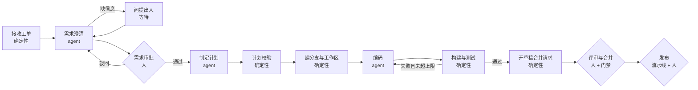

## Day88 - 从需求工单到合并请求

> 案例：编码 Agent 与研发流程 ｜ 建议用时 1 小时

> **一句话**：把“工单到合并请求”拆成一串步骤，每一步写清由代码还是由 agent 来做、交给下一步什么、在哪里停下来等人。
>
> **放在全局看**：这是本阶段的骨架图。Day89、Day90、Day92、Day93 各自展开其中一段；拆分的方法来自 Day35（工作流还是 agent），状态和审批的做法来自 Day37、Day40、Day41。

### 学习目标

- 把案例 B 的流程拆成步骤，并给每一步标上“确定性”或“agent”。
- 定义一条需求在流程中流转的状态，以及每一步交出的产物。
- 指出审批点的位置和理由。

### 核心概念

**打个比方**：像餐馆后厨的出菜流程：点单、备料、烹饪、出菜，每个工位只接上一个工位递过来的托盘；主厨站在出菜口，菜不过他这一关就不上桌。

**整体是工作流，agent 只在中间几格**

整条流程的顺序是固定的，所以外层用工作流；只有“理解需求”“制定计划”“写代码”这几步的做法要看具体任务，才交给 agent（Day35）。

**每一步交出什么**

| 步骤 | 类型 | 输入 | 交给下一步的产物 |
| --- | --- | --- | --- |
| 接收工单 | 确定性 | 工单事件 | 任务记录（工单 ID、版本、提出人），重复事件按幂等键去重 |
| 需求澄清 | agent | 工单文本 | 结构化需求草稿、待问问题（Day89） |
| 需求审批 | 人 | 需求草稿 | 已批准的需求，带版本号 |
| 制定计划 | agent | 已批准的需求、代码地图 | 结构化计划（Day44） |
| 计划校验 | 确定性 | 计划 | 校验通过的计划：动作在白名单内、步数在上限内、改动范围在允许的目录内 |
| 建分支与工作区 | 确定性 | 计划 | 分支名、隔离的工作区 |
| 编码 | agent | 计划、工作区 | 分支上的提交 |
| 构建与测试 | 确定性 | 提交 | 构建结果，失败时附上失败明细 |
| 开合并请求 | 确定性 | 分支、构建结果 | 草稿合并请求，正文链接需求和计划 |
| 评审与合并 | 人 + 门禁 | 合并请求 | 主分支上的合并提交（Day92） |
| 发布 | 流水线 + 人 | 合并提交 | 发布记录 |

两条规则让产物真正起作用：每个产物有自己的 ID 和版本；下一步只读上一步的产物，不读上一步的对话记录。编码 agent 拿到的是已批准的需求和计划，原始工单的评论区它根本看不到，这也减少了不可信文本的进入（Day93）。

**一条需求的状态**

| 状态 | 含义 | 由谁推进 |
| --- | --- | --- |
| `received` | 已接收，等待澄清 | 代码 |
| `clarifying` | 澄清 agent 运行中 | agent |
| `awaiting_requester` | 已向提出人提问，等待回答 | 人 |
| `awaiting_approval` | 需求草稿等待审批 | 人 |
| `approved` | 需求已批准 | 代码 |
| `coding` | 计划、编码、构建循环中 | agent 和代码 |
| `in_review` | 草稿合并请求等待评审 | 人 |
| `merged` | 已合并，等待发布 | 门禁 |
| `released` | 已发布 | 流水线 |
| `rejected`、`failed`、`cancelled` | 终止状态；`failed` 附带停止原因（Day45） | 代码 |

状态存在流程自己的任务记录里，经检查点保存（Day40），等人的时候进程可以退出。工单系统里显示的进度只是这份记录的投影。每次状态变化都写一条带 trace ID 的记录，事后能回答“它卡在哪、为什么停”。

**审批点放在哪**

- **需求审批。** agent 的理解从这里起成为后面所有步骤的依据，错了会一路放大。
- **合并。** 改动进入主分支后会影响其他人。
- **发布。** 对用户可见，最难撤回。

计划也可以加一次人工查看，适合改动范围大或涉及敏感目录的任务；常规任务交给确定性的计划校验即可。审批越多，流程越像人工流程，加之前先想清楚它拦的是哪一类错误。

**失败往哪走**

构建失败回到编码，次数有上限；超过上限进入 `failed`，附上最后一次的失败明细，交给人处理。需求在批准后被提出人修改，任务回到 `awaiting_approval`，已经开始的编码作废，不在旧计划上修修补补。

### 阅读材料

- GitHub Changelog [Copilot coding agent for Jira is now in public preview](https://github.blog/changelog/2026-03-05-github-copilot-coding-agent-for-jira-is-now-in-public-preview/)：一个现成产品覆盖了这张图里从“接收工单”到“开草稿合并请求”的哪几格，可以和 Day91 对照着看。

### 动手练习

1. 照着上面的表，为你自己的研发流程画一张图，每个方框标上“确定性”“agent”或“人”。
2. 为“编码”这一格写出它的输入和输出结构（字段名和类型），并写下它不允许读到的东西。
3. 选一个失败场景（例如依赖下载一直失败），沿着状态表写出这条需求会停在哪个状态、带着什么停止原因。

### 自检

1. 为什么编码 agent 只读已批准的需求，不直接读原始工单？
2. 需求在编码进行到一半时被修改，继续在原计划上改代码会有什么问题？

### 参考说明

- [Copilot coding agent for Jira is now in public preview](https://github.blog/changelog/2026-03-05-github-copilot-coding-agent-for-jira-is-now-in-public-preview/)：现成产品从工单出发、开出草稿合并请求、遵守仓库现有评审规则这一流程，用作对照。
- 其余的讲解、比方、示例和练习为本课程自己编写。
