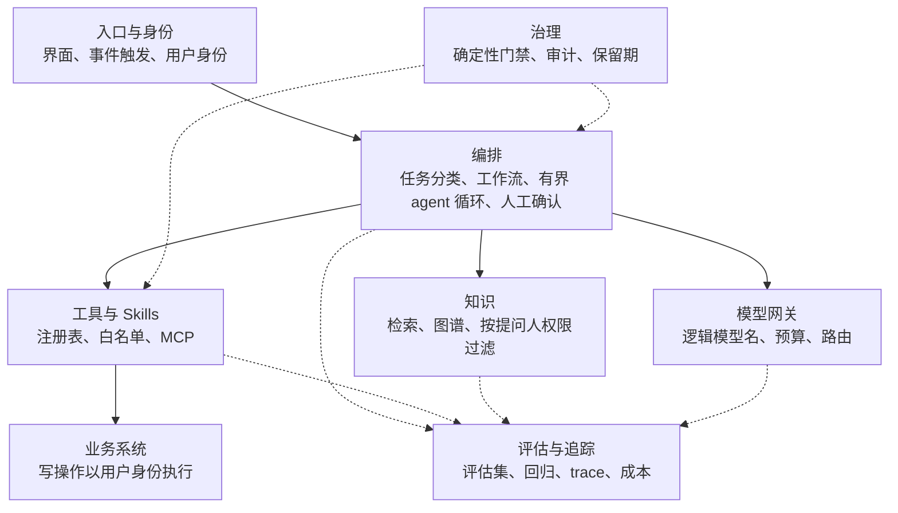

## Day96 - 参考架构

> 架构师收口 ｜ 建议用时 1 小时

> **一句话**：用一页纸告诉所有项目：在我们这里做 agent，默认应该长什么样。
>
> **放在全局看**：它是前面所有决策记录的汇总入口。

### 学习目标

把前面各阶段的决策记录和规格汇成一页参考架构，让别的项目可以直接拿去用。

### 核心概念

**打个比方**：像城市的规划图：它不替每栋楼做设计，但规定了道路、水电和红线。

**参考架构是什么**

一页图加一页说明，回答“在我们这里做一个 agent 应用，默认长什么样”。它是各项决策的汇总入口，每个方框都能链接到对应的决策记录。它给出默认选择，项目有理由时可以偏离，但要写明理由。

**分层**

**每层要写明的内容**

| 层 | 默认选择 | 对应课程 |
| --- | --- | --- |
| 入口与身份 | 身份在入口确定并一路传递；无人值守的 agent 有明确的代表身份 | Day21、Day59 |
| 编排 | 能用工作流就不用 agent；循环有四个上限；有副作用的步骤可安全重跑 | Day35–46 |
| 工具与 Skills | 工具进注册表并分风险级别；外部内容分信任等级 | Day47–56 |
| 知识 | 检索在查询层按权限过滤；回答带引用并校验 | Day11–22 |
| 模型网关 | 只有一条调用路径；记录实际模型和用量 | Day70 |
| 评估与追踪 | 评估集进仓库；CI 跑回归；追踪用开放标准 | Day23–34、Day67–69 |
| 治理 | 最终放行由确定性规则或人决定；写操作可审计 | Day57–66 |

**写的时候守住三条**

1. 每个默认选择后面跟一句理由和一个链接。
2. 写明“没选什么”。读者最想知道的常常是为什么不用另一种方案。
3. 保持一页。细节放在链接的文档里。

### 动手练习

画出你自己的版本，并为每一层填写默认选择和链接。找一位没参与过的同事读一遍，记录对方提出的前三个问题，它们就是文档里缺的内容。

### 自检

1. 参考架构和某个具体项目的架构文档有什么区别？
2. 哪一层的默认选择你最没有把握？原因是什么？

### 参考说明

本课没有新增的外部参考，内容为本课程自己整理，用到的方法来自前面各课。
