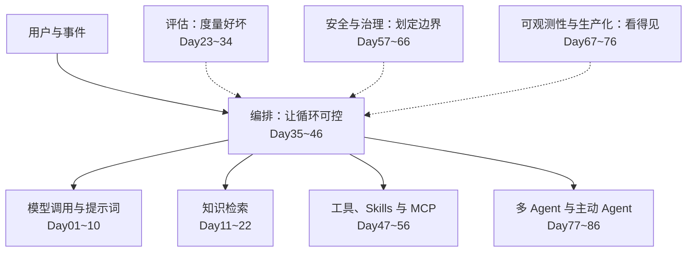

## AI Agent - 100 天从应用开发到架构设计

> **说明**：这是一套面向应用开发者的 AI agent 学习路径，编排方式参考了 [Python-100-Days](https://github.com/jackfrued/Python-100-Days)：每天一课，每课约 1 小时。目前已完成 42 天的正文，其余各天只有大纲，标注为“待更新”，会陆续补齐。

### 这门课适合谁

- 会写 Python，用过大模型的 API 或聊天产品，想系统地学会设计和实现 agent 应用。
- 已经在做 agent 项目，想补上评估、权限、安全、可观测性这些容易被跳过的部分。
- 需要评审别人的 agent 方案，想要一套提问的框架。

重点在应用层的设计和实现，不涉及模型训练。

### 怎么学

- **每天一课，先讲本质。** 每课开头用“一句话”说清这一课的核心，用“放在全局看”说明它在整个系统里的位置，再用一个生活里的比方把概念讲明白，然后才进入细节。之后是学习目标、核心概念、阅读材料、动手练习、自检，最后的“参考说明”写明这一课参考了哪些材料的哪些内容。阅读约 40 分钟，练习约 20 分钟。
- **带着一个自己的项目学。** 课程里称它为“主线项目”，示例是一个基于企业知识做问答和测试设计的平台。把每课的练习落到你自己的项目上，换成任何 agent 应用都可以。
- **两个贯穿的案例。** 案例 A 是企业知识库：把系统文档、业务资料和代码整理成知识，供人和 agent 检索。案例 B 是 AI 原生研发流程：在工单系统里描述需求，agent 优化需求，审批后编码、提交、构建、发布。很多练习会让你用当天的内容评审这两个案例。
- **每个阶段留下一份文档。** 阶段最后一课是复盘，产出决策记录、规格或威胁模型，并给设计评审清单加一节。学完 100 天，你手里有一份参考架构和一份完整的评审清单。
- **Day01~10 不用框架。** 先看清原始机制，再学框架。编排部分以 LangGraph 为例，评估和追踪以 Langfuse 为例，云平台以 Azure Foundry 为例；概念不依赖这些具体产品。

### 一张图看懂 100 天

整门课可以浓缩成一句话：**agent = 模型 + 工具 + 循环**。前两个阶段让它能做事，中间的阶段让它做得对、做得稳，后面的阶段让它安全、看得见、管得住。

中间一列是 agent 做事的主干，两侧的评估、安全和可观测性贯穿每一层。Day87~94 把这些放进一个完整案例，Day95~100 把它们收成参考架构和评审清单。

### 学完之后能做什么

1. 判断一个场景该不该用 agent，用哪种形态。
2. 为 agent 应用建立评估，让每次改动都有数据支撑。
3. 设计有上限、可恢复、带人工确认的编排。
4. 设计工具、接入 MCP 和 Skills，并划清信任边界。
5. 画出威胁模型，让防护落在权限和流程上。
6. 写出参考架构，用评审清单评审别人的方案。

### Day01~10 - 大模型应用基础

> 这一阶段回答的问题：一次模型调用，是怎样变成一个 agent 的？

#### Day01 - [认识 AI Agent](./Day01-10/01.认识AI-Agent.md)

1. Agent 的定义与三种形态
2. Agent 擅长和不擅长的事
3. Agent 系统的五个部分
4. 100 天地图

#### Day02 - [调用模型 API](./Day01-10/02.调用模型API.md)

1. 消息与角色
2. 关键参数
3. 读取回答与 token 用量
4. 把供应商收在一个函数后面

#### Day03 - [提示词基础](./Day01-10/03.提示词基础.md)

1. 清晰具体的指令
2. 给出背景和理由
3. 示例与分隔符
4. 对着测试用例迭代

#### Day04 - [结构化输出](./Day01-10/04.结构化输出.md)

1. 为什么下游代码需要结构
2. JSON Schema 与响应格式
3. 校验、带错误信息重试、重试上限

#### Day05 - [工具调用](./Day01-10/05.工具调用.md)

1. 工具调用的协议
2. 模型只提出请求，执行在你的代码里
3. 写好工具描述

#### Day06 - [手写一个 Agent 循环](./Day01-10/06.手写一个Agent循环.md)

1. 从一次调用到一个循环
2. 分发表与停止条件
3. 工具错误返回给模型
4. 步数上限

#### Day07 - [上下文窗口与成本](./Day01-10/07.上下文窗口与成本.md)

1. token 与上下文窗口
2. 输入与输出的成本
3. 提示缓存
4. 按请求做预算

#### Day08 - [流式输出与交互体验](./Day01-10/08.流式输出与交互体验.md)

1. 为什么要流式
2. 消费流
3. 多步任务的进度事件
4. 取消

#### Day09 - [错误处理与重试](./Day01-10/09.错误处理与重试.md)

1. 超时、限流与瞬时错误
2. 带抖动的指数退避
3. 副作用与幂等
4. 降级与如实告知

#### Day10 - [阶段实战：命令行问答助手](./Day01-10/10.阶段实战-命令行问答助手.md)

1. 需求与文件布局
2. 验收清单
3. 扩展目标

### Day11~22 - 知识检索

> 这一阶段回答的问题：怎样让模型基于你的资料回答，并且说得出依据？

#### Day11 - RAG 全景（待更新）

1. 检索增强生成的完整链路
2. 什么时候需要 RAG，什么时候不需要
3. 常见失败点在哪一环

#### Day12 - 文档解析与切片（待更新）

1. 不同格式的解析
2. 切片策略与边界
3. 切片的稳定标识与来源定位

#### Day13 - 向量检索（待更新）

1. embedding 是什么
2. 相似度与近似最近邻
3. 维度、模型与多语言

#### Day14 - 关键词检索与混合检索（待更新）

1. BM25 的作用
2. 结果融合（RRF）
3. 什么问题向量检索答不好

#### Day15 - [重排与上下文化检索](./Day11-22/15.重排与上下文化检索.md)

1. 两段式检索
2. 切片丢失的上下文
3. 上下文化检索的做法与效果
4. 成本在入库时支付

#### Day16 - 带引用的回答（待更新）

1. 让每个结论指向来源
2. 引用校验
3. 引用错位的处理

#### Day17 - 弃答与资料不足（待更新）

1. 什么时候应当不回答
2. 弃答的表达方式
3. 弃答率与有依据率的平衡

#### Day18 - 知识图谱入门（待更新）

1. 实体、关系与受控词表
2. 从文档抽取图谱
3. 跨文档的实体对齐

#### Day19 - 图谱增强检索与关系问答（待更新）

1. 从片段到实体再到邻居
2. 路径与多跳
3. 同时引用关系和原文

#### Day20 - [代码作为知识](./Day11-22/20.代码作为知识.md)

1. 代码与文档的差别
2. 向量切片、符号地图、现场搜索
3. 常见的组合方式

#### Day21 - [按源系统权限检索](./Day11-22/21.按源系统权限检索.md)

1. 五个必须回答的问题
2. 安全过滤字段与原生权限保留
3. 派生物的权限
4. 权限反例进评估集

#### Day22 - 阶段实战：带引用的知识问答（待更新）

1. 把 Day11–21 组合成一条链路
2. 验收清单

### Day23~34 - 评估

> 这一阶段回答的问题：怎样知道系统好不好，改动之后是变好还是变坏？

#### Day23 - [评估全景](./Day23-34/23.评估全景.md)

1. 三类评分器
2. 能力评估与回归评估
3. 评结果，不评路径

#### Day24 - [错误分析](./Day23-34/24.错误分析.md)

1. 从真实记录出发
2. 二元标注
3. 失败分类表

#### Day25 - [评估集设计](./Day23-34/25.评估集设计.md)

1. 一条用例包含什么
2. 正例、反例与不应出现
3. 离线与在线
4. 评估集版本化

#### Day26 - 代码评分器（待更新）

1. 能用代码检查的都用代码检查
2. 常见写法与例子
3. 评分器自身的测试

#### Day27 - [LLM 评审员与校准](./Day23-34/27.LLM评审员与校准.md)

1. 一个评审员只判一种失败
2. 评审标准的写法
3. 对照人工标注校准

#### Day28 - 检索评估（待更新）

1. 检索与生成分开评
2. 召回与排序指标
3. 怎样标注相关片段

#### Day29 - Agent 轨迹与工具调用评估（待更新）

1. 最终状态优先
2. 何时需要检查工具调用
3. 多步任务的部分得分

#### Day30 - [CI 回归](./Day23-34/30.CI回归.md)

1. 替身模型与真实模型两层运行
2. 阈值与基线
3. 失败时能定位到用例

#### Day31 - 在线评估与用户反馈（待更新）

1. 对生产流量抽样打分
2. 点赞点踩怎样用起来
3. 从线上失败回流到评估集

#### Day32 - 实验与对比（待更新）

1. 一次只改一个变量
2. 比较提示词、模型与检索方案
3. 读懂波动

#### Day33 - 评估平台实践（待更新）

1. 数据集、实验与评分在平台里的对应
2. 以 Langfuse 为例
3. 平台与仓库的分工

#### Day34 - [阶段复盘：评估策略](./Day23-34/34.阶段复盘-评估策略.md)

1. 评估策略决策记录
2. 评审清单的“评估”一节
3. 阶段验收

### Day35~46 - 编排：工作流与受控循环

> 这一阶段回答的问题：怎样让多步任务可控、可恢复，该停的时候停？

#### Day35 - [工作流还是 Agent](./Day35-46/35.工作流还是Agent.md)

1. 两者的界线
2. 五种工作流模式
3. 执行方式与推理方式两个维度

#### Day36 - LangGraph 入门（待更新）

1. 图、节点与边
2. 第一张图
3. 与手写循环的对应关系

#### Day37 - [状态与 Reducer](./Day35-46/37.状态与Reducer.md)

1. 状态是唯一的共享数据
2. reducer 决定更新怎样合并
3. 状态里放什么
4. 子图与契约

#### Day38 - 路由、并行与子图（待更新）

1. 用状态驱动分支，规则路由与模型路由
2. 并行节点与结果合并
3. 把独立能力做成子图，统一失败语义

#### Day39 - [反思模式](./Day35-46/39.反思模式.md)

1. 生成、检查、改写的基本结构
2. 自我反思与外部反馈
3. 用评估证明它值得
4. 轮数上限

#### Day40 - [持久化与恢复](./Day35-46/40.持久化与恢复.md)

1. 检查点与存储
2. 恢复时节点会重跑
3. 幂等键与先记后做
4. 等待时释放资源

#### Day41 - [人工确认](./Day35-46/41.人工确认.md)

1. 暂停与恢复的机制
2. 关卡设在哪
3. 审批人看到什么
4. 以谁的身份执行

#### Day42 - 流式与进度事件（待更新）

1. 图执行过程中的事件
2. 向前端推送进度
3. 断线续传

#### Day43 - [上下文工程与记忆](./Day35-46/43.上下文工程与记忆.md)

1. 上下文是有限资源
2. 压缩、笔记、子 agent、即时检索
3. 工具结果的处理规则
4. 短期记忆与长期记忆

#### Day44 - [规划模式](./Day35-46/44.规划模式.md)

1. 边做边定与先计划后执行
2. 把计划做成数据
3. 重新计划与用代码表达计划
4. 风险与控制

#### Day45 - [有界循环：预算与停止条件](./Day35-46/45.有界循环-预算与停止条件.md)

1. 四个上限
2. 停止原因枚举
3. 控制流属于你的代码
4. 数值怎么定

#### Day46 - [阶段复盘：编排规格](./Day35-46/46.阶段复盘-编排规格.md)

1. 编排规格
2. 评审清单的“编排”一节
3. 阶段验收

### Day47~56 - 工具、Skills 与 MCP

> 这一阶段回答的问题：怎样让 agent 安全地用上外部系统的能力？

#### Day47 - [工具设计](./Day47-56/47.工具设计.md)

1. 工具是给模型用的接口
2. 五条原则
3. 错误信息是提示词的一部分

#### Day48 - 工具注册表与白名单（待更新）

1. 注册表的字段
2. 只读与写、风险分级
3. 按 agent 配置可用工具

#### Day49 - 工具的错误、超时与重试（待更新）

1. 哪些错误交给模型，哪些交给代码
2. 超时与部分结果
3. 写工具的幂等

#### Day50 - [MCP 架构](./Day47-56/50.MCP架构.md)

1. 三个角色
2. Tools、Resources、Prompts
3. 两种传输
4. 接入 server 的信任问题

#### Day51 - 编写一个 MCP server（待更新）

1. 最小可用的 server
2. 工具定义与返回
3. 本地调试

#### Day52 - MCP 的认证与身份透传（待更新）

1. 远端 server 的认证
2. 把提问人的身份传到下游
3. 按请求的令牌

#### Day53 - Skills：渐进式披露（待更新）

1. Skill 是什么
2. 先给摘要，用到再加载全文
3. Skill 与工具的分工

#### Day54 - 导入外部 Skill 的信任边界（待更新）

1. 导入即引入外部文本
2. 不执行内含代码
3. 不可变版本与审核

#### Day55 - Agent 定义（待更新）

1. 系统提示词 + Skills + 工具白名单 + 模型
2. 版本化与发布
3. 系统 agent 与用户自定义 agent

#### Day56 - 阶段实战：给助手接入工具与 Skill（待更新）

1. 注册一个 MCP server
2. 导入一个 Skill
3. 验收清单

### Day57~66 - 安全与治理

> 这一阶段回答的问题：agent 会被怎样利用，防线该设在哪？

#### Day57 - [Agent 的威胁模型](./Day57-66/57.Agent的威胁模型.md)

1. 模型分不清指令和数据
2. 致命三要素
3. 用研发流程案例练一遍
4. 防护放在模型之外

#### Day58 - 提示注入与间接注入（待更新）

1. 注入从哪里进来
2. 为什么过滤不够
3. 靠设计降低影响

#### Day59 - 最小权限与 Agent 身份（待更新）

1. 每个 agent 一个身份
2. 以用户身份执行写操作
3. 权限随任务收窄

#### Day60 - 沙箱与代码执行（待更新）

1. 为什么需要隔离
2. 文件系统与网络的边界
3. 密钥不进沙箱

#### Day61 - 对照公开的风险清单（待更新）

1. OWASP 的 agent 应用风险清单
2. 逐条对照的方法
3. 结论怎样进入待办

#### Day62 - 审计与可追溯（待更新）

1. 谁在什么时候让 agent 做了什么
2. 从结果追溯到依据
3. 审计记录与追踪的关系

#### Day63 - 数据隐私与保留期（待更新）

1. 提示词和追踪里的敏感数据
2. 保留期与清理
3. 数据出域

#### Day64 - 成本与预算治理（待更新）

1. 成本核算到任务和用户
2. 预算上限与排队
3. 模型分层使用

#### Day65 - 确定性门禁（待更新）

1. agent 给建议，规则做裁决
2. 发布与审批的门禁
3. 门禁自身的测试

#### Day66 - [阶段复盘：信任模型与威胁模型](./Day57-66/66.阶段复盘-信任模型与威胁模型.md)

1. 信任模型决策记录
2. 威胁模型定稿
3. 评审清单的“工具与安全”一节

### Day67~76 - 可观测性与生产化

> 这一阶段回答的问题：怎样看见它在做什么、花了多少、哪里出了问题？

#### Day67 - 追踪：trace 与 span（待更新）

1. 一次请求的完整记录
2. 跨进程传递追踪上下文
3. 记录什么、不记录什么

#### Day68 - OpenTelemetry 与 GenAI 语义约定（待更新）

1. 为什么用开放标准
2. 常用的属性
3. 导出到不同后端

#### Day69 - [追踪与评估后端](./Day67-76/69.追踪与评估后端.md)

1. 一条追踪的结构
2. 接入 Langfuse 的两条路
3. 权威存储、保留期与查看权限

#### Day70 - [模型网关](./Day67-76/70.模型网关.md)

1. 应用与供应商之间的一层
2. 迁到目标技术栈时的选择
3. 记录实际使用的模型

#### Day71 - 延迟与成本优化（待更新）

1. 缓存
2. 模型分层与路由
3. 减少步数与并行

#### Day72 - 可靠性：队列、租约与重试（待更新）

1. 至少一次投递
2. 租约与超时回收
3. 退避与重试上限

#### Day73 - [部署形态](./Day67-76/73.部署形态.md)

1. 配置型、托管代码型与自行部署
2. 选择时要问的问题

#### Day74 - 版本化（待更新）

1. 提示词、图与状态结构的版本
2. 旧任务怎样用旧版本恢复
3. 评估与版本挂钩

#### Day75 - 发布与回滚（待更新）

1. 灰度与对比
2. 回滚的范围
3. 发布前检查项

#### Day76 - [阶段复盘：技术栈映射](./Day67-76/76.阶段复盘-技术栈映射.md)

1. 技术栈映射表
2. 评审清单的“权限与平台底座”一节
3. 阶段验收

### Day77~86 - 多 Agent 与主动 Agent

> 这一阶段回答的问题：什么时候需要不止一个 agent，它们怎样协作、怎样主动工作？

#### Day77 - [何时拆成多 Agent](./Day77-86/77.何时拆成多Agent.md)

1. 三级复杂度
2. 值得拆的信号
3. 五种编排模式
4. 契约优先

#### Day78 - 顺序、并发与交接（待更新）

1. 三种常用模式的实现
2. 交接时传什么
3. 失败时怎样收场

#### Day79 - 子 Agent 与委派（待更新）

1. 用独立上下文做探索
2. 返回浓缩后的结论
3. 委派的成本

#### Day80 - Agent 之间的契约（待更新）

1. 类型化的输入输出
2. 带状态的失败返回
3. 证据原样传递

#### Day81 - 主动 Agent：信号、触发与剧本（待更新）

1. 从“被问才答”到“主动发现”
2. 事件、节流与合并
3. 剧本的定义

#### Day82 - 提议与采纳（待更新）

1. agent 只提议，不直接写入
2. 采纳后以用户身份执行
3. 提议的生命周期

#### Day83 - 防噪与节流（待更新）

1. 去重与静默期
2. 每人每天的上限
3. 依据失效后自动过期

#### Day84 - [长时运行 Agent 的运行框架](./Day77-86/84.长时运行Agent的运行框架.md)

1. 每一轮都是失忆的
2. 初始化轮、功能清单、每轮一件事、像用户一样验证

#### Day85 - [主动 Agent 的评估](./Day77-86/85.主动Agent的评估.md)

1. 应当提议与不应当提议
2. 提议必须带依据
3. 采纳率、忽略率与过期率

#### Day86 - 阶段实战：一个主动提醒剧本（待更新）

1. 从事件到提议卡片
2. 验收清单

### Day87~94 - 案例：编码 Agent 与研发流程

> 这一阶段回答的问题：把这些放进一条真实的研发流程，会是什么样？

#### Day87 - 编码 Agent 全景（待更新）

1. 编码 agent 能做什么
2. 它依赖的工具和环境
3. 人与 agent 的分工

#### Day88 - 从需求工单到合并请求（待更新）

1. 拆解流程的每一步
2. 哪些是确定性步骤，哪些需要 agent
3. 状态与关卡

#### Day89 - 需求澄清 Agent（待更新）

1. 把模糊的需求变成可验收的描述
2. 提问而不是猜测
3. 产出的格式

#### Day90 - 编码 Agent 的验收（待更新）

1. 测试、构建与评审
2. 固定任务集与重复运行
3. 失败归因

#### Day91 - [自建还是采购](./Day87-94/91.自建还是采购.md)

1. 现成方案做到了哪一步
2. 对比的维度
3. 常见的折中

#### Day92 - 研发流程里的审批与门禁（待更新）

1. 合并与发布的放行规则
2. 职责分离
3. 紧急变更

#### Day93 - 研发流程里的安全（待更新）

1. 工单是不可信输入
2. 构建环境与密钥
3. agent 的推送权限

#### Day94 - 案例复盘（待更新）

1. 完整流程的设计文档
2. 评审清单过一遍

### Day95~100 - 架构师收口

> 这一阶段回答的问题：怎样把经验变成别人能用的架构和评审标准？

#### Day95 - 决策记录怎么写（待更新）

1. 什么值得写成决策记录
2. 写清没选什么
3. 让决定可以被检验

#### Day96 - [参考架构](./Day95-100/96.参考架构.md)

1. 参考架构是什么
2. 分层与每层的默认选择
3. 保持一页

#### Day97 - [设计评审清单](./Day95-100/97.设计评审清单.md)

1. 清单的用途
2. 怎样提问
3. 评审的产出

#### Day98 - 评审演练：企业知识库（待更新）

1. 用清单评审案例 A
2. 写出三到五条发现

#### Day99 - 评审演练：AI 原生研发流程（待更新）

1. 用清单评审案例 B
2. 写出三到五条发现

#### Day100 - 持续学习与路线更新（待更新）

1. 哪些内容会过时
2. 怎样跟进新版本
3. 把课程变成自己的知识库

### 模板

- [决策记录模板](./模板/决策记录模板.md)
- [评估集格式示例](./模板/评估集格式示例.md)
- [技术栈映射表](./模板/技术栈映射表.md)
- [威胁模型模板](./模板/威胁模型模板.md)
- [设计评审清单](./模板/设计评审清单.md)

### 其他

- [学习资源汇总](./学习资源汇总.md)：各阶段引用的外部材料。
- [更新日志](./更新日志.md)

### 参考与致谢

每一课末尾的“参考说明”逐条写明了该课参考的材料和具体内容。整门课主要参考了以下来源：

- **编排方式**：[Python-100-Days](https://github.com/jackfrued/Python-100-Days)（骆昊）。按天分课、按阶段分目录、README 作总目录的形式来自这个项目。
- **设计模式的划分**：吴恩达在 DeepLearning.AI 的 [Agentic AI](https://www.deeplearning.ai/courses/agentic-ai/) 课程。Day39 反思模式和 Day44 规划模式的选题，参考了该课程公开大纲里“反思、工具使用、规划、多 agent”四种设计模式的划分；参考的是大纲，两课的正文为本课程自己编写。这门课也是本课程推荐的视频补充。
- **工程实践**：Anthropic 工程博客的几篇文章（构建 agent、评估、上下文工程、工具设计、长时运行），用在评估、编排和工具各阶段。
- **评估方法**：Hamel Husain 与 Shreya Shankar 的 AI Evals FAQ。
- **框架与平台文档**：LangGraph、Langfuse、LiteLLM、Model Context Protocol、Microsoft Learn、GitHub Docs。
- **安全**：Simon Willison 关于“致命三要素”的文章，OWASP 的 agent 应用风险清单。
- **编排原则**：12-Factor Agents。

完整链接见 [学习资源汇总](./学习资源汇总.md)。课程正文是对这些材料的理解、组织和举例，没有照搬原文；如有理解偏差，以原始材料为准。
